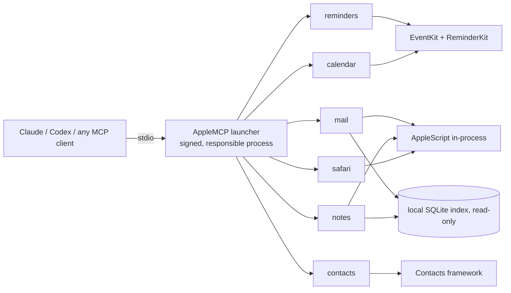

# apple-mcp-swift — MCP servers for Apple Reminders, Calendar, Mail, Notes, Contacts & Safari

**Native Swift MCP servers for Reminders, Calendar, Mail, Notes, Contacts and Safari. Zero dependencies. Every macOS permission granted once, at install: then drive your Mac from your phone.**

   

[Version française](README.fr.md)

Six [Model Context Protocol](https://modelcontextprotocol.io) servers that let Claude, Codex or any MCP client drive the Apple apps on your Mac: create reminders with subtasks, find a free slot, search your mail in milliseconds, file notes, merge duplicate contacts, read a Safari tab.

## Why this one

- **Works while you're away from your Mac.** Claude Code and Codex can run on your Mac while you drive them from your phone. If macOS shows a permission prompt then, nobody is there to click "Allow" and the call fails. Here you grant everything once, at install, and the installer checks it with a ✓/✗ table. Every server runs behind a single signed launcher, `AppleMCP`, with a stable signature, so new clients, rebuilds and restarts never ask again. Each permission is one `AppleMCP` line in System Settings, not one per server, per client or per rebuild.
- **Really native.** Subtasks, sections, tags and images in Reminders; tab groups in Safari; Mail and Notes search through their local index. No Node, no Python runtime, no MCP SDK: the protocol is ~120 lines of Swift.
- **Safe by design.** Deletions only by ID. Nothing is sent (email, invitation, reply) except by a tool whose name says so. Every tool carries MCP annotations (read-only, destructive, open-world), so clients can ask before risky calls.

## Install

Requirements: macOS 14 or later, Apple Silicon, Xcode Command Line Tools (`xcode-select --install`).

```bash
git clone https://github.com/gabythiesse/apple-mcp-swift.git
cd apple-mcp-swift
./installer.command
```

Or double-click `installer.command` in Finder. **All permissions once, never again**: the installer asks for every macOS permission the tools need while you are at the Mac, and after that no window ever appears, even when you use Claude from your phone. A few minutes the first time, 5 steps:

1. Creates a local code-signing identity "Apple MCP" in a dedicated keychain, or reuses it (a new one would make macOS ask every permission again, so it never changes without asking you).
2. Builds the six servers and the launcher, signed with that identity.
3. Asks macOS to trust the certificate: **your login password, once**.
4. Registers the six servers in the Claude desktop app and Codex, if they are installed (your config is backed up first).
5. Asks for **every permission at once**, all under the single name `AppleMCP`: click **Allow / OK** on each prompt (Reminders, Calendar, Contacts, Automation of Mail, Notes, Safari, Contacts and System Events), then turn on `AppleMCP` in **Accessibility** and **Full Disk Access** when System Settings opens (the installer waits and detects the switch).

It ends with a ✓/✗ table and says "Done" only when every line is ✓. Otherwise it says exactly which switch to turn on; run it again and it only redoes what is missing.

Before leaving home, check without changing anything:

```bash
./installer.command --check
```

The full list of permissions, and the code that needs each one: [docs/permissions.md](docs/permissions.md).

Then quit and reopen Claude, and try: *"Show me today's reminders."*

### Other MCP clients

Point any client at the launcher, with the server name as its only argument:

```json
{
  "mcpServers": {
    "reminders": { "command": "/path/to/apple-mcp-swift/bin/AppleMCP", "args": ["reminders"] },
    "calendar":  { "command": "/path/to/apple-mcp-swift/bin/AppleMCP", "args": ["calendar"] }
  }
}
```

Server names: `reminders`, `calendar`, `mail`, `notes`, `contacts`, `safari`.

## Servers and tools

Legend: 🔍 read-only · ✏️ writes · ⚠️ destructive

### Reminders (14)
| Tool | What it does |
|---|---|
| 🔍 `list_lists` | Lists, with account, color, group and incomplete count |
| ✏️ `create_list` · `update_list` | Create, rename, recolor, group lists |
| ⚠️ `delete_list` | Delete a list and its reminders, or an empty group |
| 🔍 `list_sections` · ✏️ `create_section` · ⚠️ `delete_section` | Sections inside a list |
| 🔍 `list_reminders` | Views (today, overdue, week, scheduled, flagged, recently completed), filters by list, text, tag, dates |
| ✏️ `create_reminders` · `update_reminders` | Batch create/update: due date, priority, flag, URL, alarms (time or location), recurrence, tags, subtasks |
| ✏️ `complete_reminders` | Complete or reopen |
| ⚠️ `delete_reminders` | Delete by ID (no trash) |
| ✏️ `add_image` | Attach an image to a reminder |
| 🔍 `list_tags` | Tags in use, with counts |

### Calendar (11)
| Tool | What it does |
|---|---|
| 🔍 `list_calendars` | Calendars and accounts |
| ✏️ `create_calendar` · `update_calendar` · ⚠️ `delete_calendar` | Manage calendars |
| 🔍 `list_events` | Views (today, tomorrow, week, upcoming, conflicts) or a date range; recurring events expanded |
| ✏️ `create_events` · `update_events` · ⚠️ `delete_events` | Batch events: location, alarms, recurrence, travel time, attachments; one occurrence, following or whole series |
| 🔍 `find_free_slots` | Free time across your calendars |
| ✏️ `invite` · `respond_to_invitations` | **Send** invitations / responses to attendees |

### Mail (12)
| Tool | What it does |
|---|---|
| 🔍 `list_mailboxes` | Accounts, mailboxes, unread counts, signatures |
| 🔍 `list_messages` | Fast search through Mail's index: views, mailbox, sender, dates, text |
| 🔍 `read_messages` | Full content and attachments |
| ✏️ `save_attachments` · `mark_messages` · `move_messages` | Save files, mark read/flagged/junk, move or copy |
| ⚠️ `delete_messages` | Move to Trash |
| ✏️ `create_drafts` | New, reply, reply all, forward, with attachments; sends nothing |
| ✏️ `send` | **Actually sends** email |
| ✏️ `manage_mailboxes` · ⚠️ `delete_mailboxes` | Create, rename, delete mailboxes |
| ✏️ `fetch_mail` | Check for new mail |

### Notes (13)
| Tool | What it does |
|---|---|
| 🔍 `list_folders` · `list_notes` · `read_notes` · `list_tags` | Browse and search, nested folders, plain text or HTML |
| ✏️ `create_notes` · `update_notes` | Batch create, replace or append, move |
| ⚠️ `delete_notes` | To "Recently Deleted" (or `permanent: true`) |
| ✏️ `create_folder` · `rename_folder` · ⚠️ `delete_folder` | Folders |
| ✏️ `add_attachments` · `export_attachments` | Files in and out |
| 🔍 `open_note` | Show a note in the app |

### Contacts (13)
| Tool | What it does |
|---|---|
| 🔍 `list_groups` · ✏️ `create_group` · `update_group` · ⚠️ `delete_group` | Accounts, groups and subgroups |
| 🔍 `list_contacts` | Search and read all fields, notes, photo |
| ✏️ `create_contacts` · `update_contacts` · ⚠️ `delete_contacts` | Batch edits |
| ✏️ `organize_contacts` | Add to / remove from groups |
| 🔍 `find_duplicates` · ⚠️ `merge_contacts` | Find and merge duplicates |
| ✏️ `export_vcard` · `import_vcard` | vCard files |

### Safari (14)
| Tool | What it does |
|---|---|
| 🔍 `list_tabs` · `read_page` | Windows, tabs, page text, links or HTML |
| ✏️ `open` · `navigate` · ⚠️ `close` | Open (also private windows), go, reload, back, close |
| ✏️ `run_js` | Run JavaScript in a tab |
| 🔍 `list_reading_list` · ✏️ `add_to_reading_list` · ⚠️ `delete_from_reading_list` | Reading List |
| 🔍 `list_bookmarks` · `list_history` · `list_tab_groups` | Bookmarks, history, tab groups |
| ⚠️ `delete_history` · `delete_tab_groups` | Delete history pages, tab groups |

## How it works



- **Single responsible process.** The launcher disclaims responsibility for itself (`responsibility_spawnattrs_setdisclaim`) and spawns the requested server as a child, so macOS attributes every permission to `AppleMCP`.
- **Stable local signature.** macOS ties permissions to "identifier + certificate". With a local certificate, rebuilds keep their permissions (an ad hoc signature would ask again after every build).
- **One access path per feature.** Public frameworks where they are enough, in-process AppleScript where needed, private frameworks for what Apple doesn't expose (Reminders subtasks, sections, tags and images; Notes; Safari), read-only SQLite for fast search.
- **`sondes/`** (French for "probes") holds the small experiments behind each technical choice, including the negative results.

## Limits

- **Private frameworks** (ReminderKit, NotesShared, LinkServices): a macOS update can break them.
- **Tested on macOS 26.5 only**, Apple Silicon only. You need to build from source (no prebuilt binary).
- **Some deletions drive the app's menus** and only work on a **French-language** Mac for now: `delete_mailboxes` (Mail) and Safari's `delete_history`, `delete_tab_groups`, `delete_from_reading_list`. Contributions with English menu titles are welcome.
- **Tests touch your real data.** `*/tests/smoke.py` creates `MCP-TEST-<timestamp>` items in the real apps and checks that nothing is left; they never send email or invitations. No CI (it would need a Mac with permissions granted).

## Development

```bash
./build.sh reminders-mcp                          # build + sign one server
./build.sh --all                                  # everything
python3 -I reminders-mcp/tests/smoke.py bin/...   # smoke test (real data, see above)
```

**Permission rule.** A tool that reaches a new service (another app through Apple Events, a new protected folder, a new framework with its own permission) must be added in the same change to [docs/permissions.md](docs/permissions.md) and to `Permissions.services` in `launcher/Sources/AppleMCP/Permissions.swift`, so the installer asks for it and `--check` tests it. A permission prompt after installation is a bug.

Each server has the same layout: `Protocol.swift` (MCP), `Tools.swift` (names, descriptions, schemas), `Handlers.swift` (logic), plus the access layer (`EventKit`, `AppleScript`, `Index`, `Private`). Some code comments are still in French.

## FAQ

### Can I use it from my phone, away from my Mac?
Yes. That is what it was built for. Claude Code and Codex both let you drive a session on your Mac from mobile. Permissions are all granted at install and survive rebuilds, so no macOS prompt appears while you are away and nothing blocks waiting for a click.

### How do I connect Claude to Apple Reminders on my Mac?
Run `./installer.command` (see [Install](#install)). It registers the servers in the Claude desktop app and Codex, then you ask Claude in plain language: *"Remind me to call the bank tomorrow at 9."*

### Can Claude read and send Apple Mail?
Yes. `list_messages` and `read_messages` search Mail's local index, `create_drafts` prepares emails without sending them, and only `send` actually sends one.

### Does it work with MCP clients other than Claude?
Yes. Any MCP client that speaks stdio can call the `AppleMCP` launcher (see [Other MCP clients](#other-mcp-clients)).

### How is it different from other Apple MCP servers?
It is native Swift with no Node or Python runtime, it uses private frameworks for features AppleScript can't reach (Reminders subtasks, sections, tags and images), and every server runs behind one signed launcher, so every macOS permission shows a single `AppleMCP` entry.

### Why does macOS only show `AppleMCP`?
The launcher is the responsible process for all six servers, so each permission (Reminders, Calendar, Contacts, Automation, Accessibility, Full Disk Access) has one `AppleMCP` line, whatever the server or the client. Its stable local signature keeps them across rebuilds (see [How it works](#how-it-works)). The full list, with the code behind each one: [docs/permissions.md](docs/permissions.md).

## License

[MIT](LICENSE)
