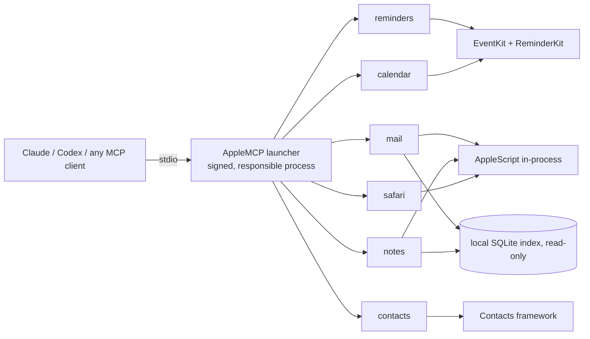

# apple-mcp-swift

**Native Swift MCP servers for Reminders, Calendar, Mail, Notes, Contacts and Safari. Zero dependencies. One macOS permission.**

   

[Version française](README.fr.md)

Six [Model Context Protocol](https://modelcontextprotocol.io) servers that let Claude, Codex or any MCP client drive the Apple apps on your Mac: create reminders with subtasks, find a free slot, search your mail in milliseconds, file notes, merge duplicate contacts, read a Safari tab.

## Why this one

- **One permission.** Every server runs behind a single signed launcher, `AppleMCP`. System Settings shows one `AppleMCP` switch, not one per server, per client or per rebuild.
- **Really native.** Subtasks, sections, tags and images in Reminders; tab groups in Safari; Mail and Notes search through their local index. No Node, no Python runtime, no MCP SDK: the protocol is ~120 lines of Swift.
- **Safe by design.** Deletions only by ID. Nothing is sent (email, invitation, reply) except by a tool whose name says so. Every tool carries MCP annotations (read-only, destructive, open-world), so clients can ask before risky calls.

## Install

Requirements: macOS 14 or later, Apple Silicon, Xcode Command Line Tools (`xcode-select --install`).

```bash
git clone https://github.com/gabythiesse/apple-mcp-swift.git
cd apple-mcp-swift
./installer.command
```

Or double-click `installer.command` in Finder. It takes a few minutes the first time and does 7 steps:

1. Creates a local code-signing identity "Apple MCP" in a dedicated keychain.
2. Builds the six servers and the launcher, signed with that identity.
3. Asks macOS to trust the certificate: **your login password, once**.
4. Registers the six servers in the Claude desktop app and Codex, if they are installed (your config is backed up first).
5. Calls each server once: **click "Allow"** on each `AppleMCP` prompt (Reminders, Calendar, Contacts, Automation).
6. Opens **Full Disk Access**: turn on `AppleMCP` (Mail reads its local index).
7. Opens **Accessibility**: turn on `AppleMCP` (Safari private windows and deletions).

Then quit and reopen Claude, and try: *"Show me today's reminders."*

### Other MCP clients

Point any client at the launcher, with the server name as its only argument:

```json
{
  "mcpServers": {
    "reminders": { "command": "/path/to/apple-mcp-swift/bin/AppleMCP", "args": ["reminders"] },
    "calendar":  { "command": "/path/to/apple-mcp-swift/bin/AppleMCP", "args": ["calendar"] }
  }
}
```

Server names: `reminders`, `calendar`, `mail`, `notes`, `contacts`, `safari`.

## Servers and tools

Legend: 🔍 read-only · ✏️ writes · ⚠️ destructive

### Reminders (14)
| Tool | What it does |
|---|---|
| 🔍 `list_lists` | Lists, with account, color, group and incomplete count |
| ✏️ `create_list` · `update_list` | Create, rename, recolor, group lists |
| ⚠️ `delete_list` | Delete a list and its reminders, or an empty group |
| 🔍 `list_sections` · ✏️ `create_section` · ⚠️ `delete_section` | Sections inside a list |
| 🔍 `list_reminders` | Views (today, overdue, week, scheduled, flagged, recently completed), filters by list, text, tag, dates |
| ✏️ `create_reminders` · `update_reminders` | Batch create/update: due date, priority, flag, URL, alarms (time or location), recurrence, tags, subtasks |
| ✏️ `complete_reminders` | Complete or reopen |
| ⚠️ `delete_reminders` | Delete by ID (no trash) |
| ✏️ `add_image` | Attach an image to a reminder |
| 🔍 `list_tags` | Tags in use, with counts |

### Calendar (11)
| Tool | What it does |
|---|---|
| 🔍 `list_calendars` | Calendars and accounts |
| ✏️ `create_calendar` · `update_calendar` · ⚠️ `delete_calendar` | Manage calendars |
| 🔍 `list_events` | Views (today, tomorrow, week, upcoming, conflicts) or a date range; recurring events expanded |
| ✏️ `create_events` · `update_events` · ⚠️ `delete_events` | Batch events: location, alarms, recurrence, travel time, attachments; one occurrence, following or whole series |
| 🔍 `find_free_slots` | Free time across your calendars |
| ✏️ `invite` · `respond_to_invitations` | **Send** invitations / responses to attendees |

### Mail (12)
| Tool | What it does |
|---|---|
| 🔍 `list_mailboxes` | Accounts, mailboxes, unread counts, signatures |
| 🔍 `list_messages` | Fast search through Mail's index: views, mailbox, sender, dates, text |
| 🔍 `read_messages` | Full content and attachments |
| ✏️ `save_attachments` · `mark_messages` · `move_messages` | Save files, mark read/flagged/junk, move or copy |
| ⚠️ `delete_messages` | Move to Trash |
| ✏️ `create_drafts` | New, reply, reply all, forward, with attachments; sends nothing |
| ✏️ `send` | **Actually sends** email |
| ✏️ `manage_mailboxes` · ⚠️ `delete_mailboxes` | Create, rename, delete mailboxes |
| ✏️ `fetch_mail` | Check for new mail |

### Notes (13)
| Tool | What it does |
|---|---|
| 🔍 `list_folders` · `list_notes` · `read_notes` · `list_tags` | Browse and search, nested folders, plain text or HTML |
| ✏️ `create_notes` · `update_notes` | Batch create, replace or append, move |
| ⚠️ `delete_notes` | To "Recently Deleted" (or `permanent: true`) |
| ✏️ `create_folder` · `rename_folder` · ⚠️ `delete_folder` | Folders |
| ✏️ `add_attachments` · `export_attachments` | Files in and out |
| 🔍 `open_note` | Show a note in the app |

### Contacts (13)
| Tool | What it does |
|---|---|
| 🔍 `list_groups` · ✏️ `create_group` · `update_group` · ⚠️ `delete_group` | Accounts, groups and subgroups |
| 🔍 `list_contacts` | Search and read all fields, notes, photo |
| ✏️ `create_contacts` · `update_contacts` · ⚠️ `delete_contacts` | Batch edits |
| ✏️ `organize_contacts` | Add to / remove from groups |
| 🔍 `find_duplicates` · ⚠️ `merge_contacts` | Find and merge duplicates |
| ✏️ `export_vcard` · `import_vcard` | vCard files |

### Safari (14)
| Tool | What it does |
|---|---|
| 🔍 `list_tabs` · `read_page` | Windows, tabs, page text, links or HTML |
| ✏️ `open` · `navigate` · ⚠️ `close` | Open (also private windows), go, reload, back, close |
| ✏️ `run_js` | Run JavaScript in a tab |
| 🔍 `list_reading_list` · ✏️ `add_to_reading_list` · ⚠️ `delete_from_reading_list` | Reading List |
| 🔍 `list_bookmarks` · `list_history` · `list_tab_groups` | Bookmarks, history, tab groups |
| ⚠️ `delete_history` · `delete_tab_groups` | Delete history pages, tab groups |

## How it works



- **Single responsible process.** The launcher disclaims responsibility for itself (`responsibility_spawnattrs_setdisclaim`) and spawns the requested server as a child, so macOS attributes every permission to `AppleMCP`.
- **Stable local signature.** macOS ties permissions to "identifier + certificate". With a local certificate, rebuilds keep their permissions (an ad hoc signature would ask again after every build).
- **One access path per feature.** Public frameworks where they are enough, in-process AppleScript where needed, private frameworks for what Apple doesn't expose (Reminders subtasks, sections, tags and images; Notes; Safari), read-only SQLite for fast search.
- **`sondes/`** (French for "probes") holds the small experiments behind each technical choice, including the negative results.

## Limits

- **Private frameworks** (ReminderKit, NotesShared, LinkServices): a macOS update can break them.
- **Tested on macOS 26.5 only**, Apple Silicon only. You need to build from source (no prebuilt binary).
- **Some deletions drive the app's menus** and only work on a **French-language** Mac for now: `delete_mailboxes` (Mail) and Safari's `delete_history`, `delete_tab_groups`, `delete_from_reading_list`. Contributions with English menu titles are welcome.
- **Tests touch your real data.** `*/tests/smoke.py` creates `MCP-TEST-<timestamp>` items in the real apps and checks that nothing is left; they never send email or invitations. No CI (it would need a Mac with permissions granted).

## Development

```bash
./build.sh reminders-mcp                          # build + sign one server
./build.sh --all                                  # everything
python3 -I reminders-mcp/tests/smoke.py bin/...   # smoke test (real data, see above)
```

Each server has the same layout: `Protocol.swift` (MCP), `Tools.swift` (names, descriptions, schemas), `Handlers.swift` (logic), plus the access layer (`EventKit`, `AppleScript`, `Index`, `Private`). Some code comments are still in French.

## License

[MIT](LICENSE)
